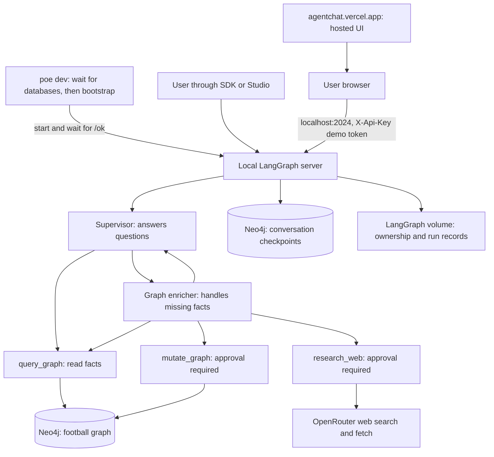
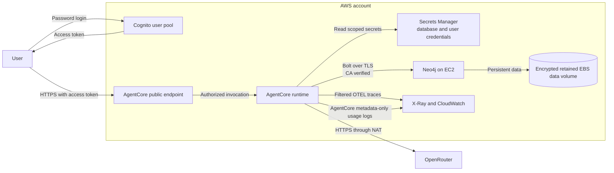
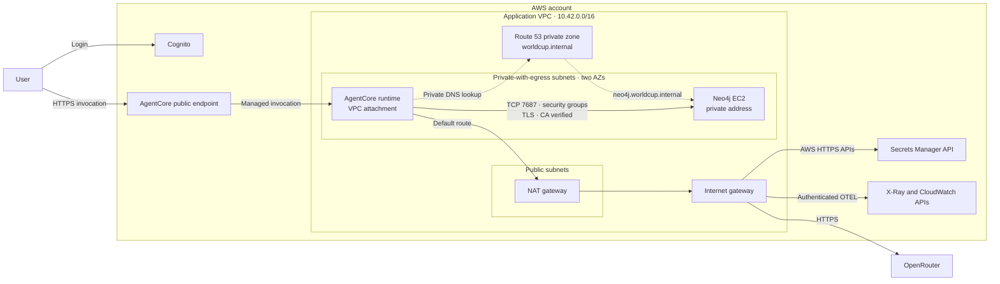
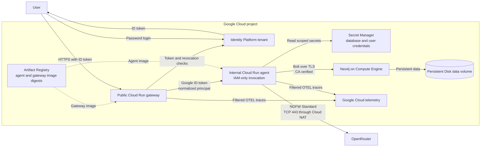
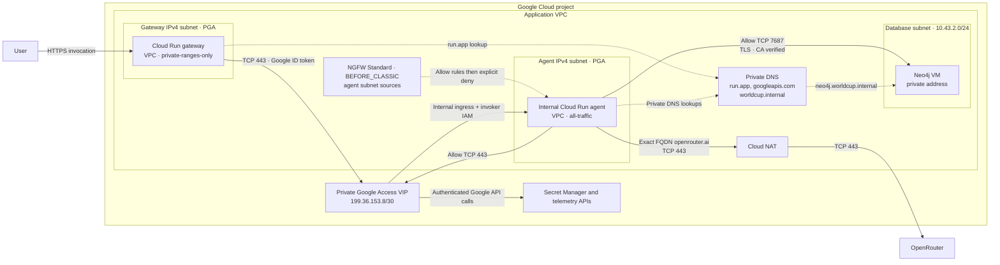

# Architecture

World Cup Graph Agent is a Python tutorial project that answers World Cup
questions from Neo4j. It can research missing information and propose
database changes.
Research and changes each require user approval. The application runs locally;
it is not a production service.

See [FEATURES.md](FEATURES.md) for user-facing features.
The [README chapters](../README.md#chapters) provide the learning path.
[Production considerations](PRODUCTION.md) discuss conditional approaches
beyond the implemented design; [Evidence](EVIDENCE.md) describes result status.

## Two graphs

The **football graph** lives in Neo4j. Teams, players, and matches are nodes;
squad membership and other connections are relationships. Queries follow those
relationships to answer football questions.

The **execution graph** runs in LangGraph. It coordinates model calls, tools,
conversation state, and approval pauses. It is not the football database.

### Local startup

`poe dev` waits for the Neo4j development and evaluation services to become
healthy, runs development bootstrap, then recreates the LangGraph server and
waits for `/ok` to succeed. Bootstrap provisions the application users before
the server opens its checkpoint connection. A failed bootstrap prevents server
startup, and a failed health check makes the command fail. Existing graph data
and checkpoint volumes persist across this startup sequence.

### Agent assembly

The local runtime takes the authenticated identity, resolves its OpenRouter key,
and supplies database drivers to the agent factory. The factory uses DeepAgents
to build two agents on LangGraph:

- The **supervisor** answers questions and has `query_graph` for database reads.
- The **graph enricher** handles missing facts and has `query_graph`,
  `research_web`, and `mutate_graph`.

OpenRouter supplies their models and a separate research model. Model and
provider settings are configurable for each role. A tool is a Python operation
the model can request; the supervisor cannot directly research or write data.

Provider sorting is also configurable per role. An explicit provider list takes
precedence over sorting and disables provider fallbacks. The judge is used only
in evals.

Packaged **skills** provide instructions and schema references. Both agents can
read the querying skill; the enricher also has the enrichment skill. They cannot
rewrite these files. The schema defines supported records, relationships, and
properties. Stable IDs identify records across queries and change proposals.

The local server manages persistence. Scenario evals use the same factory with
their own database connections and checkpointer.

## Answering a question

For “What is Brazil's FIFA code?”:

1. The caller authenticates, creates a conversation, and sends the question.
2. The server builds the agent for this execution.
3. The supervisor writes **Cypher**, Neo4j's query language, using the querying
   skill's schema reference and instructions.
4. `query_graph` executes it with a reader account and returns rows.
5. The supervisor answers from those rows. It owns the final answer even when
   it delegates work to the enricher.

Database permissions enforce read-only querying. Answer grounding is a model
instruction checked by evals, not a database guarantee.

### Query inputs and results

`query_graph` takes a Cypher statement and a separate dictionary of parameters.
It passes both to Neo4j unchanged. The model must interpret results and repair
failed queries; the tool does not rewrite Cypher.

A successful result contains rows and a `truncated` flag. It returns at most
25 rows, capped at 128 KiB, with a 120-second query timeout. A truncated result
is not a complete list; the model may need to narrow or page its query.

Rows must contain JSON-compatible values, such as strings, numbers, lists, and
maps. Queries should select the needed properties instead of returning native
Neo4j nodes or paths. Unsupported values, oversized payloads, timeouts, and
database errors produce an error result, not partial rows. Neither an error nor
an empty result proves that a real-world fact is false.

## When information is missing

The supervisor delegates supported information gaps to the graph enricher.
The enricher follows this sequence:

1. Query existing records to identify the gap and their IDs.
2. Propose a research question and wait for approval.
3. If approved, research it; if rejected, end the attempt.
4. Propose graph changes with evidence and a risk description, then wait for
   a separate approval.
5. If approved, validate and apply the batch in one database transaction.
6. Report the outcome to the supervisor, which queries the graph again before
   answering the original question.

Approvals use LangGraph **interrupts**: execution pauses with a pending tool
request, and a resume command supplies an approve or reject decision. Free-text
chat is not approval, and approving research does not authorize its resulting
database changes. Ordinary model calls can also incur costs.

Code enforces approval gates and mutation validation. The model must choose the
gap and follow the research/update/re-query sequence. The outcome report is not
football evidence: the supervisor must retrieve the stored facts.

### Research

`research_web` receives a focused question and a reason for researching it.
It uses the research model with OpenRouter's server-side search and page-fetch
tools. The result separates findings from unanswered questions. Each finding
includes an answer, explanation, and source links, titles, and excerpts.
These sources are model-reported, not independently verified citations.

Search, page fetching, and output size are bounded. The tool makes at most two
attempts to obtain the structured result; if both fail, it reports the question
as unanswered. A guard refuses further research after usable findings are
available for the current update, or after research is rejected. It relies on
retained conversation messages.

### Database changes

`mutate_graph` receives a list of operations, their reasons and evidence, and an
overall risk description. Its four operation types are:

- `create_node`: add a supported record, with an application-derived ID.
- `fill_node_properties`: supply missing values on an existing record.
- `create_relationship`: connect identified records with a supported relation.
- `fill_relationship_properties`: supply supported missing relationship values.

The tool validates operation shape, schema types, targets, and missing
properties. It cannot delete records or overwrite values. Filling an existing
value fails even if the proposed value is identical. An existing propertyless
connection can be left unchanged; duplicate record or squad membership creation
fails.

Operations run in the approved order, so a later operation can use a record
created earlier in the batch. The writer uses one transaction: all changes
succeed or none are kept. Results identify the applied operations or the failed
operation and rollback. Failed proposals are not automatically retried.

Application code generates the write queries. The model supplies structured
operations, not arbitrary Cypher.

## Conversation access

The football graph is shared, but conversations are private. Approved enrichment
therefore becomes available to both demo users without sharing their chats.

The local server identifies Alice or Bob through public demo tokens supplied
as Bearer authorization or `X-Api-Key` by Agent Chat. Explicit Bearer
credentials take precedence. Both credential headers are excluded from
HTTP header logging.
These demonstrate authentication, not secure accounts. Development admin
endpoints and trusted operators are outside the per-user access boundary.

A **thread** is the server's identifier for a conversation; a **run** is an
execution within it. Creating a thread assigns its owner from authentication,
overriding any owner supplied by the caller. Read and search hooks use that same
owner to restrict visible threads, including stored state and history. Runs and
approval resumes require an existing thread owned by the caller.

The run hook accepts user-message input or a resume-only command. Agent Chat's
empty approval input is normalized to no input. Text messages use SDK roles or
the UI's human-message type and text blocks; other content and state fields
are rejected. Client message IDs are discarded to prevent history overwrites.
Arbitrary state-changing commands and subgraph checkpoint selectors are denied.
Root checkpoint IDs sent by the UI are discarded: every turn continues current
state rather than branching from a client-selected snapshot. Runs use `reject`
or `enqueue` concurrency, so a new run cannot interrupt or replace an
active one.

These are server authorization hooks. Direct graph calls bypass them, which is
why API access checks need their own eval.

### Model credentials

Each execution, including a resume, obtains an OpenRouter key from the trusted
identity and builds fresh models with it. Both demo identities receive the same
configured key through a local fixture. There is no credential store or secret
encryption implementation. Graph introspection builds the topology without
resolving a user's credential or running inference.

## Persistence and approval resumes

- **Football data:** the Neo4j `worldcup` database stores shared facts.
- **Conversation checkpoints:** `worldcup-checkpoints` stores execution state
  so conversations and approval pauses can continue. A checkpoint is a saved
  execution snapshot.
- **Server records:** the LangGraph volume stores ownership and run records.
  Checkpoints alone do not supply the server's access-control metadata.

At an interrupt, saved execution state records the pending action so the caller
can inspect it. A resume supplies a decision on the same thread. LangGraph loads
the stored state and continues the enrichment attempt, which can pause again
for mutation approval.

### Why the checkpoint saver is customized

`CheckpointSaver` extends the library's Neo4j saver for three storage gaps:

- It makes task writes wait for their checkpoint to exist, preventing concurrent
  storage calls from silently losing pending results such as interrupt IDs.
- It adds unique version suffixes because the library's channel-state storage
  identifies values by channel and version, without a conversation identifier.
- It reloads full checkpoint tuples for history, including state and pending
  writes needed to display approvals.

The saver does not implement approval policy. Decisions follow native LangGraph
interrupt semantics, without application-level single-use guarantees.

## Local development

Bootstrap creates databases, permissions, schema constraints, and seed data,
and renders the schema reference for the querying skill. Docker runs the local
LangGraph server and Neo4j, plus a separate Neo4j service for scenario evals.
Callers use the SDK, Studio, or the hosted Agent Chat UI. Agent Chat runs in
the user's browser and connects directly to the loopback-bound development
server with a demo token in its API-key field. The browser needs local-network
access and, for remote development, a forwarded port. The UI's upload, edit,
regenerate, and cancel controls are outside the supported API workflow.

Studio lets a developer inspect state and resume approvals. LangSmith traces
record model and tool activity, tagged by model role. Metadata excludes
credentials, but conversation content is visible to trusted trace operators.

## Hosted deployments

These curated diagrams describe the operational architecture defined by the
current deployment and runtime code. They group supporting resources so the
request, data, telemetry, and network paths stay readable. They are not an
inventory of a particular running account or project.

### AWS overview

The user authenticates directly with Cognito and sends the resulting access
token to the public AgentCore endpoint. AgentCore authorizes the request and
runs the agent with private VPC connectivity.

Sources: [AWS CDK stack][aws-stack], [AWS client][aws-client],
[hosted configuration][hosted-configuration], and [cloud telemetry][telemetry].

### AWS network

The AgentCore service exposes the public endpoint outside the application VPC.
Its runtime uses private-with-egress subnets in two availability zones. Security
groups admit Bolt only from the runtime group to the database group. The private
Route 53 zone resolves the database name to its private address.

The NAT path carries runtime HTTPS egress because the stack defines no VPC
endpoints. The database also has private-subnet egress for host operations; it
does not carry agent model traffic.

Sources: [AWS CDK stack][aws-stack], [AWS client][aws-client], and
[hosted configuration][hosted-configuration].

### GCP overview

The user authenticates directly with the deployment's Identity Platform tenant.
The public Cloud Run gateway verifies the ID token and revocation state. It
invokes a separate internal Cloud Run agent with a normalized principal rather
than forwarding the user's token. The gateway obtains a Google ID token with
the agent service URL as its audience. Only the gateway workload identity has
the agent's Cloud Run invoker role; internal ingress and IAM both apply.

Both services use immutable image digests in the same Artifact Registry
repository. The agent reserves at least one instance, scales to at most two,
and uses two CPUs, 4 GiB of memory, concurrency four, and always-allocated CPU.

Sources: [GCP runtime Terraform][gcp-runtime],
[GCP database Terraform][gcp-database], [GCP gateway][gcp-gateway],
[GCP client][gcp-client], [hosted configuration][hosted-configuration], and
[cloud telemetry][telemetry].

### GCP network

The gateway and agent use Direct VPC egress with separate IPv4 subnets. The
gateway uses `private-ranges-only`; private `run.app` DNS resolves invocation
through the Private Google Access VIP range `199.36.153.8/30`. Private Google
Access is enabled on the gateway subnet. User login and gateway token checks
retain their public authentication path.

The agent uses `all-traffic` egress. Its subnet enables Private Google Access;
private `googleapis.com` DNS resolves Google APIs to `199.36.153.8/30`. Cloud
NAT supplies public egress for permitted OpenRouter connections. Database
private DNS resolves the Neo4j VM; Bolt uses TCP 7687 with CA-verified TLS.

A global Cloud NGFW Standard network firewall policy is associated with the
VPC and evaluated `BEFORE_CLASSIC`. Every rule is source-scoped to the agent
subnet. In priority order it allows the private database address on TCP 7687,
the private Google API VIP range on TCP 443, and the exact FQDN `openrouter.ai`
on TCP 443, then explicitly denies all other agent egress. The agent policy
does not constrain gateway or database host traffic. The database subnet has
Cloud NAT for host provisioning and maintenance.

Standard FQDN rules match DNS-derived destination IP addresses, not the actual
HTTPS hostname. Other hosts sharing an allowed IP can be reachable. Traffic
uses ordinary DNS; this policy is not a DNS-query allowlist. There is no TLS
inspection or endpoint-side hostname enforcement. The shared Google API VIP
also permits access to Google frontends; IAM, not this address rule, limits
authorized resources.

Cached FQDN destinations can remain reachable after DNS returns `NXDOMAIN`;
the allowlist does not provide immediate DNS-based revocation. Resolver
outages, `SERVFAIL`, and cache-expiry guarantees remain unverified. The
[controlled observations](EVIDENCE.md#private-gcp-verification) establish only
the tested cases.
The [manual checklist](DEVELOPMENT.md#gcp-network-smoke-checklist) defines the
checks; a diagram or Terraform plan is not execution evidence.

Sources: [GCP network Terraform][gcp-network],
[GCP runtime Terraform][gcp-runtime],
[GCP database Terraform][gcp-database], and
[hosted configuration][hosted-configuration].

### Hosted invocation

The hosted runtimes share one strict JSON contract for conversation creation,
listing, bounded reading, user-message submission, and approval resumption.
Extra fields and type coercion are rejected, and errors use sanitized codes.
Both cloud adapters invoke the same ownership, admission, and graph execution
policy. The contract is defined in [contracts][contracts].

`HostedPrincipal` represents verified issuer, subject, and optional tenant.
Its structured identity digest is independent of email and display name. The
internal invocation envelope carries this principal separately from public
request input. AWS verifies Cognito access-token signature, issuer, expiry,
client, and token type. The Google gateway verifies tenant-specific login tokens
and sends only the normalized principal and a W3C trace carrier to the agent.
The internal assertion requires gateway-scoped invocation IAM.

`HostedConversation` metadata in the checkpoint database stores immutable
ownership and execution admission, not messages or graph progress. A Neo4j
write transaction fences competing workers; request-fenced completion holds
admission through checkpoint persistence. Failed executions become uncertain;
elapsed time never authorizes replay. Reads and listings enforce ownership.

Approval cards bind exact action arguments, checkpoint, and interrupt identity.
Resume checks card identities, cardinality, ordering, and decision types before
resolving credentials. A single delegated interrupt uses the documented flat
native decision payload; multiple interrupts use ID-addressed native values.
Pending approval blocks ordinary chat. State inspection uses graph APIs without
inference or managed-user-key resolution.

Settings select a local, AWS, or GCP runtime. Hosted selection requires
encrypted `bolt://` and a public CA certificate. Driver construction validates
the CA and uses Neo4j's custom-CA trust with server identity verification;
it does not change global HTTPS trust. Shared reader/writer and short-lived
bootstrap drivers use the same TLS configuration. Local plaintext is explicit.
Hosted settings do not require a global OpenRouter key, and local fixture
credential resolution denies hosted selection. Managed resolvers derive secret
names from canonical identity and the deployment namespace. Every execution
builds fresh credential-bound models; missing keys fail closed.

The enricher's public LangChain completion hook ends its delegation on a native
rejection or typed applied mutation. It derives the orchestration report from
that result without further model inference or research details. Native
research/write interrupts and the supervisor's post-write graph read remain
separate steps.

Checkpoint pending-write batches are atomic. Reads coalesce identical duplicate
records and reject conflicting progress as `execution_uncertain`, preserving
stored data for operator inspection. Both hosted adapters verify approval
snapshots and deny consumed approvals.

The dependency lock resolves the AWS and GCP serving, telemetry, and gateway
exports together, separate from CDK and Terraform infrastructure dependencies.
Each deployment uses an immutable, timestamped folder. Artifacts include exact
agent skills and schema and exclude environment files and bootstrap assets.
CDK defines AWS application resources; stable-provider Terraform defines the
Google Cloud Run services, Identity Platform tenant, Direct VPC subnets, DNS,
Cloud NAT, and Cloud NGFW Standard policy. GCP build artifacts are separate
agent and gateway `tar.gz` container build contexts with Dockerfiles and locked
requirements. Publishing builds both images with Docker and pushes them to
one Artifact Registry repository; deployment consumes both immutable digests.

Deployment consumes an exact build and refuses to create infrastructure
implicitly. AWS protects the database from replacement with a CloudFormation
stack policy. GCP rejects Terraform plans that delete or replace protected
resources. Generated passwords stay in a protected store, and supplied
passwords stay in protected inputs.

Shared bootstrap resources have a lifecycle independent of application
teardown. Cloud resources are authoritative: missing infrastructure produces
failure rather than an implicit deployment. Public conversation clients use
password login without end-user cloud credentials or downstream retries.

Serving readiness uses disposable synchronous probes; async serving connections
open and close on their owning event loop. AWS uses ARM64 agent compute and
a pinned x86 database VM with independently retained encrypted EBS storage.
Database bootstrap installs locked project dependencies on the selected host
architecture.

Cloud OTEL initializes before graph and client imports. The export boundary
filters all enabled spans to allowlisted metadata and drops events, links, and
exception descriptions. Explicit content capture sanitizes the selected bridge
payloads. Token usage survives output masking. The gateway uses fixed span names
and propagates only validated W3C context, not JWTs or arbitrary baggage.
AWS service delivery uses metadata-only usage logs.

Teardown requires explicit target, deployment, and data-loss confirmation.
Discovery uses CloudFormation and remote Terraform state rather than local
outputs or serving artifacts. Shared bootstrap, project initialization, tracing,
and platform service-agent grants are preserved. Service-controlled networking
that cannot be released is reported as pending rather than forced. Cloud
audit and trace retention and shared artifacts have independent lifetimes.

## Evaluations

Evals run scenarios to check behavior that prompts alone cannot guarantee:

Cloud calls require explicit `--hosted` authorization; marker expressions only
select cases. Hosted scenarios reject research approvals and never authorize
graph mutation.

- **Grounded answers:** compare required facts with answer text and successful
  graph rows, and check actual execution for research or mutation, including
  activity inside isolated subagents.
- **Enrichment:** scenarios require a research approval and a completed
  conversation. Rejection must execute neither research nor mutation and leave
  the stored birthplace unchanged. Approval must store the expected fact,
  execute research before an applied mutation, and produce a successful
  post-mutation supervisor graph read. A language-model judge separately checks
  the final prose against the expected outcome and graph rows.
- **Access isolation:** real SDK requests check authentication, trusted owner
  assignment, private state/history, and cross-user chat/resume rejection.
- **Credential wiring:** distinct fake keys check supervisor, enricher, and
  research model configuration without inference. This catches mistakes that
  the shared demo key could hide. Introspection must skip credential resolution.
- **Adapter integration:** local checks exercise serving startup and
  dispatch, then restore, reject, and reject replay of a persisted approval
  through a fresh adapter while enforcing conversation ownership.
- **Hosted smoke checks:** opt-in public requests verify authentication,
  keyless denial, one grounded answer, cross-user isolation, persisted approval
  rejection, and replay denial on AWS and GCP. Natural signed-token expiry is
  outside the current acceptance coverage.

Pytest discovers async scenario functions using the configuration in
`pyproject.toml`. Grounded cases use native parameterization with stable case
IDs. Enrichment functions compose small message and approval helpers directly.
They handle one interrupt at a time, with one decision per requested action.
Research and mutation require separate approval rounds; unexpected or mixed
actions fail the scenario. Approved conversations have at most four rounds.
Assertions establish exact outcomes; OpenEvals supplies semantic judging and
native binary feedback with reasoning. `EvalSettings` validates the required
judge model ID when settings are loaded.

`evals/conftest.py` wires resources and their lifetimes on one async event loop
and configures LangSmith reporting for the pytest session.
`evals/database.py` owns bootstrap and resets. `EvalSettings.neo4j_uri` is a
class-level constant for the dedicated service at `bolt://localhost:7688`,
excluded from environment and constructor configuration. Database helpers
require `EvalSettings`. `evals/runtime.py` provides the `ConversationRunner`
callable used by the `conversation_runner` fixture. It accepts message or
approval-resume requests and returns LangGraph conversation state. Every
invocation resolves credentials and builds fresh models.
`evals/evidence.py` reads supervisor evidence and the native local run
collector, because isolated subagent tool messages are absent from supervisor
history.
`evals/reporting/` owns scenario examples, metadata, and billed-cost export.
Scenario and evaluation modules stay within their grounded,
enrichment, or auth families.

Database scenarios execute sequentially; failed bootstrap or reset aborts
execution. Ordinary scenario failures retain pytest tracebacks and allow other
cases to run. Local execution evidence is available with uploads disabled.

The session-scoped, autouse `development_server` fixture in
`evals/conftest.py` starts the development stack, including the eval Neo4j
service, once per session and waits for it to become healthy. Access checks
target the local API and use the server's development database; direct graph
scenarios use the isolated eval database.

LangSmith's pytest integration records grounded and enrichment cases in one
suite, including nested agent traces, model metadata, OpenRouter costs, and
judge feedback. Scenario inputs exclude runtime fixtures. Access and credential
checks use ordinary pytest reporting without requiring judge or eval-reporting
settings. Eval-process uploads can be disabled independently of server tracing.
Model calls and research still incur costs. The enrichment judge is
model-dependent; passing does not establish correctness for every question.

## Where to start reading the code

- [Agent factory][factory]: models, tools, specialist, and approval wiring.
- [Prompts][agent] and [skills][skills]: instructions and schema references.
- [Tools][tools]: the read, research, and mutation boundaries.
- [Local runtime][runtimes]: server integration and authorization hooks.
- [Infrastructure][infrastructure]: Neo4j persistence and credential fixture.
- [Evaluations][evals]: scenario functions, fixtures, and checks.

[factory]: ../src/world_cup_graph_agent/agent/factory.py
[agent]: ../src/world_cup_graph_agent/agent
[skills]: ../src/world_cup_graph_agent/skills
[tools]: ../src/world_cup_graph_agent/tools
[runtimes]: ../src/world_cup_graph_agent/runtimes
[infrastructure]: ../src/world_cup_graph_agent/infrastructure
[evals]: ../evals
[contracts]: ../src/world_cup_graph_agent/runtimes/contracts.py
[aws-stack]: ../deploy/aws/stack.py
[aws-client]: ../scripts/aws/converse.py
[gcp-runtime]: ../deploy/gcp/runtime.tf
[gcp-network]: ../deploy/gcp/network.tf
[gcp-database]: ../deploy/gcp/database.tf
[gcp-gateway]: ../src/world_cup_graph_agent/runtimes/gateway.py
[gcp-client]: ../scripts/gcp/converse.py
[hosted-configuration]: ../src/world_cup_graph_agent/runtimes/configuration.py
[telemetry]: ../src/world_cup_graph_agent/observability/telemetry.py
